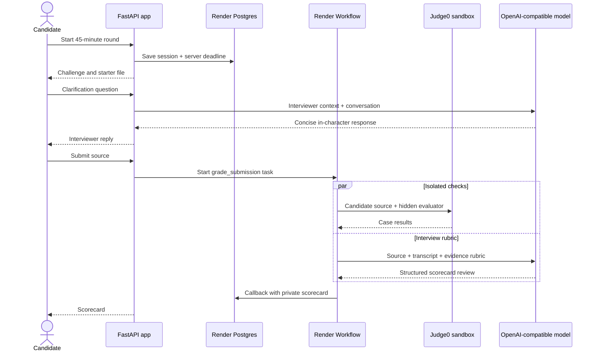

# InterviewSim architecture

The web service stores session state and never executes candidate source. Render Workflow tasks coordinate the grader and written rubric review. Candidate code is sent only to the configured Judge0-compatible service with CPU, memory, and network controls. The Nonilion route accepts a canonical event model until its official event schema and reply method are verified.

